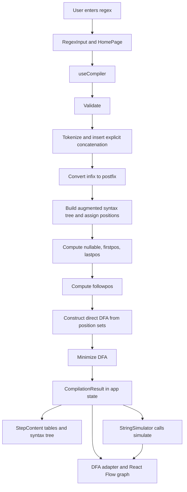

# DFA Visualizer — Faculty Project Report

**Prepared:** 25 October 2026  
**Repository revision inspected:** `main`, `fa292a7` (`docs(ui): update homepage subtitle to reflect direct DFA construction`)  
**Purpose:** Source-grounded description for faculty review and project demonstration.

> **Verification note.** The report describes implementation found in source and tests at the revision above. The Git log records commit authors and messages, but does not establish who conceived, reviewed, or completed each feature. Team contributions and AI tool usage therefore remain for the team to confirm.

## A. Project overview

### Problem and motivation

An ordinary regular-expression tool usually reports only whether a string matches or returns a finished automaton. In a compiler-design course, that hides the construction steps students need to understand. DFA Visualizer makes the direct regular-expression-to-DFA procedure inspectable: users can enter a supported expression and view its tokens, explicit concatenation, postfix form, augmented syntax tree, position analysis, followpos table, direct DFA, minimized DFA, and string simulation.

### Objectives

1. Implement the direct syntax-tree / followpos method for constructing a DFA.
2. Expose intermediate compiler data in a browser interface for learning and demonstration.
3. Keep compiler logic independent from React and graph rendering.
4. Check algorithm behavior with unit, contract, component, visualization, and integration tests.

### Scope and user workflow

The active grammar supports one-character ASCII letters and digits as literals, alternation `|`, implicit concatenation, postfix Kleene star `*`, and parentheses. Whitespace is ignored. The input `.` is rejected because it is reserved internally to show explicit concatenation. Empty input/groups, unsupported characters, malformed operators, and unbalanced parentheses are rejected with compiler errors. Features such as `+`, `?`, character classes, escapes, anchors, and backreferences are not supported.

From a user's perspective: enter an expression in **Regular expression**, press **Convert**, then select a compilation step in the step navigation. At the final **String Simulation** step, enter a string into **Input string** and press **Run**. The result displays **ACCEPTED** or **REJECTED**, an execution trace, and a graph that highlights the current transition as the user steps through it.

## B. Technical architecture

### Layer responsibilities

| Layer            | Responsibility                                                                                                                                                     | Important paths                                                                                                                                                                                                                                |
| ---------------- | ------------------------------------------------------------------------------------------------------------------------------------------------------------------ | ---------------------------------------------------------------------------------------------------------------------------------------------------------------------------------------------------------------------------------------------- |
| Compiler         | Validate and transform regex input; build syntax analysis, position sets, direct/minimized DFA; simulate strings. It is pure TypeScript and does not import React. | `src/compiler/compiler.ts`, `src/compiler/validator.ts`, `src/compiler/directDfa.ts`, `src/compiler/minimizeDfa.ts`, `src/compiler/simulator.ts`, `src/compiler/types.ts`                                                                      |
| UI / application | Collect input, own current expression and selected step, call compiler via a hook, present data and errors.                                                        | `src/pages/HomePage.tsx`, `src/context/AppContext.tsx`, `src/hooks/useCompiler.ts`, `src/components/`                                                                                                                                          |
| Visualization    | Adapt compiler values to graph structures, calculate positions, route and render edges/nodes, expose graph controls and highlighting.                              | `src/visualization/adapters/dfaAdapter.ts`, `src/visualization/layout/graphLayout.ts`, `src/visualization/layout/treeLayout.ts`, `src/visualization/components/AutomataGraph.tsx`, `TransitionEdge.tsx`, `DfaGraph.tsx`, `SyntaxTreeGraph.tsx` |
| Tests            | Check individual compiler stages and automaton contracts, visualization adapters/layout/components, UI pieces, and the real app shell wiring.                      | `tests/compiler/`, `tests/visualization/`, `tests/components/`, `tests/integration/`, `tests/fixtures/`                                                                                                                                        |

The compiler's `CompilationResult` in `src/compiler/types.ts` is the data contract consumed by the rest of the application. `src/compiler/index.ts` and `src/visualization/index.ts` are public module entry points. The UI connects these layers in `HomePage`; visualization components receive data and do not invoke `compileRegex` themselves.

### Verified data flow



The simulation occurs when requested by the UI, not during `compileRegex`; the simulator uses the minimized DFA in `HomePage`.

## C. Technology stack

Versions below distinguish package declarations from `package-lock.json` resolution. Lockfile versions are the repository's recorded dependency resolutions; they are not a claim about globally installed software.

| Technology                   | Declared range → lockfile version                                                                                  | Use and suitability                                                                                                                       |
| ---------------------------- | ------------------------------------------------------------------------------------------------------------------ | ----------------------------------------------------------------------------------------------------------------------------------------- |
| React / React DOM            | `^18.3.1` → `18.3.1`                                                                                               | Component UI and state-driven rendering fit the interactive, staged application.                                                          |
| TypeScript                   | `~5.6.3` → `5.6.3`                                                                                                 | Types shared across compiler, UI, and graph adapters make automaton contracts explicit. `tsconfig.app.json` enables strict type checking. |
| Vite                         | `^6.0.5` → `6.4.3`                                                                                                 | Serves the app in development and builds production static assets; `npm run build` also invokes TypeScript project build.                 |
| `@xyflow/react` (React Flow) | `^12.3.5` → `12.11.6`                                                                                              | Interactive nodes, edges, viewport, pan/zoom and selection; project code supplies custom automata nodes, edges, layout, and controls.     |
| Vitest                       | `^3.2.7` → `3.2.7`                                                                                                 | Test runner configured through `vite.config.ts`, sharing Vite aliases and plugin setup.                                                   |
| Testing Library              | React `^16.1.0` → `16.3.3`; DOM `^10.4.0` → `10.4.2`; user-event `^14.5.2` → `14.6.7`; jest-dom `^6.6.3` → `6.9.1` | Tests components through accessible user interactions and rendered DOM. `jest-dom` provides DOM assertions.                               |
| jsdom                        | `^25.0.1` → `25.0.1`                                                                                               | Supplies a DOM environment for component/integration tests.                                                                               |
| ESLint                       | `^9.17.0` → `9.39.5`                                                                                               | Static linting configured in `eslint.config.js` with TypeScript, React Hooks, and React Refresh rules.                                    |
| Prettier                     | `^3.4.2` → `3.9.8`                                                                                                 | Formats TypeScript, CSS, JSON, and Markdown using `.prettierrc`; a check script exists.                                                   |

Other relevant development packages include `@vitejs/plugin-react` (`^4.3.4`, lockfile `4.7.0`), `typescript-eslint` (`^8.18.1`, lockfile `8.70.0`), and `eslint-config-prettier` (`^9.1.0`, lockfile `9.1.2`). The repository is npm-based: `package-lock.json` is present. Exact lock versions were read from it on 25 October 2026.

React provides reusable UI and context/state. TypeScript checks contracts and compiler data shape. Vite is the development server and production bundler. React Flow provides the interactive graph canvas; graph semantics and layout remain project-owned. Vitest and Testing Library cover pure algorithms and user-facing UI behavior. ESLint and Prettier enforce static rules and formatting.

## D. Compiler design and theoretical foundation

### Grammar and pipeline

The supported expression language has a small alphabet of one-character alphanumeric literals. `|` means alternation, juxtaposition means concatenation, `*` means zero or more repetitions, and parentheses group expressions. Precedence is star, concatenation, then alternation. The compiler uses the direct construction based on an augmented regular-expression syntax tree. The active pipeline does **not** construct a Thompson ε-NFA and does **not** perform NFA subset construction.

| Stage                   | Purpose and rule                                                                                                                                                                                      | Input → output                                              | Implementation                           |
| ----------------------- | ----------------------------------------------------------------------------------------------------------------------------------------------------------------------------------------------------- | ----------------------------------------------------------- | ---------------------------------------- |
| Validation              | Reject malformed expressions before later stages; preserves the first useful error and source index.                                                                                                  | Raw string → valid or `RegexSyntaxError`                    | `src/compiler/validator.ts`, `errors.ts` |
| Tokenization            | Removes whitespace and emits the meaningful characters in order.                                                                                                                                      | String → `string[]`                                         | `src/compiler/tokenizer.ts`              |
| Explicit concatenation  | Inserts internal `.` between an operand-ending token (literal, `)`, `*`) and operand-starting token (literal, `(`).                                                                                   | Tokens → tokens with dots                                   | `src/compiler/explicitConcatenation.ts`  |
| Infix to postfix        | Shunting-yard conversion; `*` has highest precedence, then `.`, then `                                                                                                                                | `; parentheses are removed.                                 | Explicit infix tokens → postfix tokens   | `src/compiler/infixToPostfix.ts` |
| Augmented syntax tree   | Builds an AST and concatenates its root expression with a distinguished end marker `#`.                                                                                                               | Postfix → `SyntaxNode` tree                                 | `src/compiler/syntaxTree.ts`             |
| Position numbering      | Assigns unique, deterministic 1-based positions to all leaves, including `#`, left-to-right.                                                                                                          | Tree → leaf position table and marker position              | `src/compiler/positions.ts`              |
| Nullable                | Determines whether a subtree can derive the empty string. Symbol = false; union = OR; concatenation = AND; star = true.                                                                               | Tree → boolean on every node                                | `src/compiler/nullable.ts`               |
| Firstpos                | Finds positions that can begin a string from a subtree. For concatenation, include the right firstpos only when the left child is nullable.                                                           | Annotated tree → sorted position sets                       | `src/compiler/firstpos.ts`               |
| Lastpos                 | Finds positions that can end a string from a subtree. For concatenation, include the left lastpos only when the right child is nullable.                                                              | Annotated tree → sorted position sets                       | `src/compiler/lastpos.ts`                |
| Followpos               | At concat `A.B`, add `firstpos(B)` to each position in `lastpos(A)`; at `A*`, add `firstpos(A)` to each position in `lastpos(A)`.                                                                     | Annotated tree and leaf table → one sorted set per position | `src/compiler/followpos.ts`              |
| Direct DFA construction | Start with `firstpos(root)`. From set `S` on symbol `a`, union `followpos(p)` for each `p ∈ S` whose leaf symbol is `a`. Intern each unique sorted set as a state.                                    | Root, alphabet, followpos, `#` position → partial DFA       | `src/compiler/directDfa.ts`              |
| Minimization            | Moore-style partition refinement after unreachable and non-live states are removed. Missing transitions are treated as a distinct rejection target for refinement; the resulting DFA remains partial. | DFA → equivalent minimized DFA                              | `src/compiler/minimizeDfa.ts`            |
| Simulation              | Consumes a string character-by-character, recording state transitions and stopping at an unknown symbol or missing edge.                                                                              | DFA and string → verdict plus trace                         | `src/compiler/simulator.ts`              |

The result of `compileRegex` includes all intermediate values, both DFA forms, and run-specific descriptions for the navigation steps. `simulate` is a separate call.

### Key definitions

- **Nullable(node):** whether that expression subtree can produce the empty string.
- **Firstpos(node):** leaf positions that may be the first consumed symbol of a string generated by that subtree.
- **Lastpos(node):** leaf positions that may be the last consumed symbol.
- **Followpos(p):** positions that may immediately follow leaf position `p` in a string generated by the whole augmented expression.
- **End marker `#`:** a unique terminal leaf appended to the expression. A DFA state is accepting exactly when its position set contains the position of `#`; this marks that a complete match of the original expression has been reached.

Position sets are canonical sorted arrays without duplicates. DFA state ids are assigned in discovery order beginning at numeric id `0`, displayed in the UI as `q0`, and so on. A DFA has no epsilon transitions. An absent transition is not materialized as a dead state; it means rejection.

### Worked example: `(a|b)*abb`

The expression means any sequence of `a` and `b` followed by `abb` (equivalently, strings over `{a,b}` ending in `abb`). It is in the repository's supported example set and has explicit test coverage.

The verified compiler stages include:

```text
Tokens:                 ( a | b ) * a b b
Explicit concatenation: (a|b)*.a.b.b
Postfix:                ab|*a.b.b.
Leaf positions:         1:a, 2:b, 3:a, 4:b, 5:b, 6:#
Root firstpos:           {1, 2, 3}
Root lastpos:            {6}
```

The compiler test `tests/compiler/compiler.test.ts` checks the full followpos table, direct-DFA transitions and accepting states for this expression. It verifies four direct DFA states and four minimized states. Those exact values are test-derived, not inferred from the documentation. The accepting direct-DFA state contains position 6, the marker. The language tests verify that `abb`, `aabb`, `babb`, `abbabb`, and `bbabb` are accepted; empty string, `a`, `ab`, `abba`, and `bb` are rejected. The report omits reproducing the full transition/followpos tables; see the cited test for exact values.

### Retained NFA-related code

`NFA`, epsilon constants, mock automata, `adaptNfa`, `NfaGraph`, and `NfaTable` remain in source and tests. They represent a standalone NFA visualization/contract and historical compatibility fixtures. `CompilationResult.nfa` and `DFAState.nfaStates` are explicitly deprecated compatibility fields. The active `compileRegex` result does not populate an NFA, and the active page does not render an NFA stage. It would be inaccurate to present NFA construction as implemented by the current compiler.

## E. User interface and visualization

### User workflow and observed controls

`src/pages/HomePage.tsx` presents the title **Regular Expression to DFA Visualizer**, an input labelled **Regular expression**, a **Convert** submit button, selectable examples, an error area, and step navigation. The nine active steps are Regular Expression, Tokenization, Explicit Concatenation, Postfix Notation, Syntax Tree & Positions, Followpos Table, Direct DFA Construction, Minimized DFA, and String Simulation.

The syntax-tree step renders `SyntaxTreeGraph`, `PositionTable`, and `AstAnalysisTable`. The followpos step renders `FollowposTable`. Direct and minimized DFA steps render `DfaGraph`, `TransitionTable`, and `DfaMapping`. The simulation step uses the minimized DFA. `StringSimulator` presents a labelled **Input string** field, **Run**, trace navigation buttons (**Prev**, **Next**, **Reset**), and the verdict. Error messages are surfaced through `ErrorDisplay`; invalid input does not become an automaton.

### Graph adaptation and interactions

`adaptDfa` maps compiler states to graph nodes whose IDs are strings derived from numeric IDs. Node data carries the numeric state id, `qN` label, start/accepting flags, and the syntax-tree `positions` set. Each non-epsilon transition becomes a separate edge with a stable id. Parallel edges between a state pair remain separate and are offset; identical duplicate `(from,to,symbol)` transitions are deduplicated. A `null` symbol in a DFA is treated as invalid and throws.

`layoutAutomaton` performs deterministic breadth-first layering from the start state. It sorts neighbors and states, excludes self-loops from layer assignment, assigns unreachable states positions, and spreads states across each layer. `treeLayout.ts` assigns syntax tree positions bottom-up, sequencing leaves and centering parents over children.

`AutomataGraph` uses React Flow's pan/zoom/select/drag capabilities and project custom `StateNode`/`TransitionEdge` renderers. Edge routing handles self-loops and back edges; parallel and bidirectional edges get separate Bézier curves, while labels and arrowheads identify transitions. User drag positions are stored locally and reset when graph identity changes. Simulation supplies highlighted states/transitions to the graph. The graph exposes controls and selected-state props; the current `HomePage` does not wire general state selection to cross-highlight other tables.

### Live demonstration sequence

Use the detailed timings and exact actions in [FACULTY_DEMO_GUIDE.md](FACULTY_DEMO_GUIDE.md). In brief: introduce the learning goal, compile `(a|b)*abb`, inspect explicit concatenation/postfix, inspect the syntax tree and followpos, show direct and minimized DFA, then run `abb` and `ab` to explain acceptance and rejection. This sequence is source-grounded; actual browser rendering should be rehearsed on the presentation machine before claiming a successful live demo.

## F. Implemented functionality and project status

| Feature                                                   | Status                                                | Evidence                                                                                                                                                 | Notes / limitations                                                                                               |
| --------------------------------------------------------- | ----------------------------------------------------- | -------------------------------------------------------------------------------------------------------------------------------------------------------- | ----------------------------------------------------------------------------------------------------------------- |
| Regex validation and error messages                       | Implemented                                           | `src/compiler/validator.ts`; `tests/compiler/validator.test.ts`; `tests/compiler/compiler.test.ts`                                                       | First detected syntax error is reported; no error recovery collecting multiple errors.                            |
| Tokenization, explicit concatenation, postfix conversion  | Implemented                                           | `src/compiler/tokenizer.ts`, `explicitConcatenation.ts`, `infixToPostfix.ts`; corresponding `tests/compiler/*`                                           | Single-character alphanumeric literals; no escape/class grammar.                                                  |
| Augmented syntax tree and position analysis               | Implemented                                           | `src/compiler/syntaxTree.ts`, `positions.ts`, `nullable.ts`, `firstpos.ts`, `lastpos.ts`; `tests/compiler/syntaxTree.test.ts`, `positions.test.ts`, etc. | `#` is internal to augmented tree and not a user literal.                                                         |
| Followpos and direct DFA construction                     | Implemented                                           | `src/compiler/followpos.ts`, `directDfa.ts`; `tests/compiler/followpos.test.ts`, `directDfa.test.ts`, textbook test in `compiler.test.ts`                | Direct position-set algorithm; no active Thompson/subset pipeline.                                                |
| DFA minimization                                          | Implemented                                           | `src/compiler/minimizeDfa.ts`; `tests/compiler/minimizeDfa.test.ts`, compiler equivalence checks                                                         | Removes unreachable and non-live states then refines partitions.                                                  |
| String simulation                                         | Implemented                                           | `src/compiler/simulator.ts`, `src/components/StringSimulator.tsx`; `tests/compiler/simulator.test.ts`, `tests/components/ui.test.tsx`                    | Missing transition or out-of-alphabet symbol rejects early with trace.                                            |
| Syntax tree / tables / direct and minimized graph UI      | Implemented                                           | `src/pages/HomePage.tsx`, `src/visualization/components/*`, `tests/visualization/*`, `tests/integration/appShell.test.tsx`                               | Integration test verifies compilation reaches the app but not all graph semantics end-to-end.                     |
| DFA graph interaction and routing                         | Implemented                                           | `src/visualization/components/AutomataGraph.tsx`, `TransitionEdge.tsx`, `StateNode.tsx`; `tests/visualization/graphs.test.tsx`, layout tests             | Drag/select, pan/zoom and graph controls exist. Manual browser behavior was not checked for this report.          |
| Step navigation accessibility                             | Partial                                               | `src/components/StepNavigation.tsx`; `tests/components/ui.test.tsx`                                                                                      | ARIA tab roles and selection exist; arrow keys, Home/End, and roving tabindex remain an explicit TODO.            |
| Input accessibility/error association                     | Partial                                               | `src/components/RegexInput.tsx`, `ErrorDisplay.tsx`                                                                                                      | Input label and alert exist; source TODO notes missing `aria-describedby` and validation-as-you-type.             |
| NFA visualization                                         | Implemented as standalone compatibility functionality | `src/visualization/components/NfaGraph.tsx`, `NfaTable.tsx`, `nfaAdapter.ts`; `tests/visualization/*`                                                    | Not part of `compileRegex` or the current page's stage flow.                                                      |
| Browser responsive/accessibility/performance verification | Needs verification                                    | CSS and UI specs exist; no browser run recorded here                                                                                                     | Rehearse viewport sizes and keyboard/screen-reader behavior with team before making claims.                       |
| Future language features and export                       | Not implemented                                       | `docs/REGEX_SPECIFICATION.md`; future ideas in `docs/FUTURE_ENHANCEMENTS.md`                                                                             | `+`, `?`, character classes, escapes, anchors, backreferences, export, persistence are not in the active product. |

The active implementation can be demonstrated in source/tests, but this report did not run a browser or visually inspect the page. Current team ownership and contribution completion are not assigned based on code style or commit counts.

## G. Testing and verification

### Test design

- `tests/compiler/` tests individual algorithms and the public `compileRegex`/`simulate` flow. The compiler suite includes a worked textbook example, automaton invariants, determinism checks, and bounded-language equivalence checks between direct and minimized DFAs.
- `tests/visualization/` tests adapters, layout determinism, syntax tree layout, tables, and graph components using fixtures.
- `tests/components/` tests UI elements through Testing Library user-visible controls and labels.
- `tests/integration/` renders the real `App`, checks invalid-input error display, and verifies valid input compiles without a user-facing alert.
- Vitest is configured for jsdom in `vite.config.ts` and uses `src/test/setup.ts`.

### Executed validation

The following commands were run on **25 October 2026** using the dependencies already present in `node_modules`; no packages were installed or changed.

| Exact command          | Result                                                                                                                                                                                                                                 |
| ---------------------- | -------------------------------------------------------------------------------------------------------------------------------------------------------------------------------------------------------------------------------------- |
| `npm run typecheck`    | **PASS** — `tsc -b`, exit 0.                                                                                                                                                                                                           |
| `npm run lint`         | **PASS** — ESLint, exit 0.                                                                                                                                                                                                             |
| `npm test`             | **PASS** — 22 test files, 413 tests, exit 0.                                                                                                                                                                                           |
| `npm run build`        | **PASS** — TypeScript build and Vite production bundle, exit 0; Vite reported 6.4.3.                                                                                                                                                   |
| `npm run format:check` | **FAIL** — exit 1. Prettier reports `docs/DECISIONS.md`, `docs/VISUALIZATION_SPEC.md`, `src/components/StringSimulator.tsx`, `src/visualization/components/AutomataGraph.tsx`, and `src/visualization/components/SyntaxTreeGraph.tsx`. |

The typecheck, lint, test, and build commands were re-run for this report. Formatting remains a failed project-wide check. No browser, manual accessibility, responsive viewport, or performance test was run.

## H. Challenges, engineering decisions, and limitations

### Evidence-backed design choices

- **Direct construction:** The active `directDfa.ts` starts at `firstpos(root)` and forms transitions from `followpos`; `compiler.ts` explicitly excludes Thompson construction, epsilon closure, and subset construction. This makes the position-based construction itself visible to learners. Its educational benefit is an interpretation of the implementation and stated project purpose, not an empirical evaluation.
- **Compiler/visualization separation:** Compiler modules are plain TypeScript and `DfaGraph` receives a `DFA` prop, adapts it, and passes nodes/edges to shared rendering. This gives algorithm tests a DOM-free path and lets graph tests use independent fixtures.
- **Partial DFA convention:** Missing transitions mean reject; the compiler does not add an explicit sink for empty target sets. Minimization uses a special missing-transition signature so absence is preserved meaningfully.
- **Deterministic presentation:** Compiler positions are sorted and state sets are interned canonically. Layout sorts graph neighbors and assigns BFS layers so repeated render inputs yield stable positions. Edge curves are explicitly offset so multiple symbols between state pairs can remain individually labelled.
- **Browser-first computation:** The inspected package and source implement a client-side Vite app; no server/API dependency appears in this pipeline. Do not infer deployment or hosting from that fact.

### Limitations and caveats

The grammar is intentionally small. The UI's step navigation lacks expected keyboard tab interaction; text input lacks inline validation and the error display is not associated through `aria-describedby` per source TODOs. These are verified source-level gaps, not statements that the UI is unusable. The NFA model and components remain for fixtures/compatibility, which may confuse readers if docs describe them as the current compiler path. Existing integration coverage could assert more of the graph/simulation seam. The formatting check fails on five files. No manual browser, accessibility audit, or large-graph performance assessment is claimed.

## I. Future improvements

| Priority | Improvement                                                                                             | Type                                | Effort | Evidence / next step                                                                                              |
| -------- | ------------------------------------------------------------------------------------------------------- | ----------------------------------- | ------ | ----------------------------------------------------------------------------------------------------------------- |
| High     | Implement accessible keyboard tab behavior: roving focus, arrows, Home/End.                             | Confirmed issue                     | M      | `StepNavigation.tsx` TODO; add interaction tests and verify keyboard-only behavior.                               |
| High     | Link validation errors to input and consider validation feedback as users type.                         | Confirmed source TODO / improvement | S/M    | `RegexInput.tsx` TODO; preserve current submit feedback and add accessible association tests.                     |
| Medium   | Reconcile architecture, setup, integration, and status documentation with direct-DFA implementation.    | Confirmed documentation drift       | M      | Existing project overview and implementation guides describe retired/pending work. Preserve historical decisions. |
| Medium   | Add an integration assertion that a known DFA stage and simulator verdict are reachable through the UI. | Improvement                         | S/M    | Extend `tests/integration/appShell.test.tsx` without relying on React Flow internals.                             |
| Medium   | Rehearse responsive layout and accessibility with browser/device or assistive technology.               | Needs verification                  | M      | No such manual verification was performed for this report. Record tested browser/viewport/assistive technology.   |
| Low      | Profile layout before optimizing repeated `includes`, `shift`, and max scans.                           | Optional                            | S/M    | `graphLayout.ts`; no performance defect has been measured. Optimize only if representative profiling supports it. |
| Low      | Decide deprecation policy for NFA compatibility fields/components.                                      | Human decision                      | M/L    | Check downstream consumers and fixture needs before any API removal.                                              |

## J. Conclusion

DFA Visualizer is an implemented educational web application for examining direct regular-expression-to-DFA construction. Its TypeScript compiler exposes the syntax-tree position analysis, followpos, direct and minimized automata, and simulation trace; React presents those stages and React Flow renders interactive automata. On the audit date, typecheck, lint, all 413 tests, and production build passed; Prettier check did not. A source-grounded demonstration can show compilation of `(a|b)*abb`, inspect intermediate stages, compare the direct/minimized DFA, and simulate accepted/rejected strings. Before faculty presentation, the team should rehearse the browser workflow, resolve contribution/AI disclosures, and be candid about keyboard-accessibility and formatting gaps.

### Team Contributions — To Be Confirmed by Team

The repository has person-based area assignments in `CONTRIBUTING.md`, and Git logs commit identities, but neither proves the actual distribution of design, implementation, testing, review, or presentation work. Team members should complete this table themselves:

| Team member (as presented) | Work personally completed                                 | Work reviewed / tested   | Evidence or clarification                                             |
| -------------------------- | --------------------------------------------------------- | ------------------------ | --------------------------------------------------------------------- |
| [Name]                     | [Compiler, UI, visualization, tests, documentation, etc.] | [Review/testing details] | [Commits are evidence of recorded commits only, not full authorship.] |
| [Name]                     | [Fill in]                                                 | [Fill in]                | [Fill in]                                                             |
| [Name]                     | [Fill in]                                                 | [Fill in]                | [Fill in]                                                             |

### AI tool use — disclosure template

The repository does not establish whether or how AI tools were used. Do not present either use or non-use as fact without team confirmation. Adapt this statement to actual practice and institutional rules:

> “We used [tool(s), if any] for [specific activities such as brainstorming, code explanation, test ideas, editing, or report drafting]. AI-generated suggestions were [reviewed/modified/verified in the following way]. The implementation and final technical claims were checked by the team using [tests, source review, or other evidence]. The following parts were written or changed with AI assistance: [list].”

If no AI tools were used, state that only after the whole team confirms it. Do not attribute this audit report's verification or writing to project implementation authors.

## K. References

### Repository references

- [README](../README.md), [project architecture summary](../ARCHITECTURE.md), [contributor guide](../CONTRIBUTING.md), [root agent instructions](../AGENTS.md).
- [Compiler pipeline](COMPILER_PIPELINE.md), [regex specification](REGEX_SPECIFICATION.md), [data contracts](DATA_CONTRACTS.md), [API contract](API_CONTRACT.md), [visualization specification](VISUALIZATION_SPEC.md), [testing strategy](TESTING_STRATEGY.md), [decisions](DECISIONS.md).
- Compiler: `src/compiler/compiler.ts`, `validator.ts`, `tokenizer.ts`, `explicitConcatenation.ts`, `infixToPostfix.ts`, `syntaxTree.ts`, `positions.ts`, `nullable.ts`, `firstpos.ts`, `lastpos.ts`, `followpos.ts`, `directDfa.ts`, `minimizeDfa.ts`, `simulator.ts`, `types.ts`.
- UI and graphs: `src/pages/HomePage.tsx`, `src/hooks/useCompiler.ts`, `src/context/AppContext.tsx`, `src/components/StepNavigation.tsx`, `RegexInput.tsx`, `StringSimulator.tsx`, `src/visualization/adapters/dfaAdapter.ts`, `src/visualization/layout/graphLayout.ts`, `treeLayout.ts`, `src/visualization/components/AutomataGraph.tsx`, `TransitionEdge.tsx`, `DfaGraph.tsx`, `SyntaxTreeGraph.tsx`.
- Tests: `tests/compiler/compiler.test.ts`, `tests/compiler/directDfa.test.ts`, `tests/compiler/minimizeDfa.test.ts`, `tests/compiler/simulator.test.ts`, `tests/visualization/adapters.test.ts`, `layout.test.ts`, `graphs.test.tsx`, `tests/components/ui.test.tsx`, `tests/integration/appShell.test.tsx`.
- Configuration: `package.json`, `package-lock.json`, `tsconfig.app.json`, `vite.config.ts`, `eslint.config.js`, `.prettierrc`.

### Official technology documentation

- React: [Learn React](https://react.dev/learn).
- TypeScript: [TypeScript Handbook](https://www.typescriptlang.org/docs/handbook/).
- Vite: [Getting Started](https://vite.dev/guide/).
- React Flow: [Building a Flow](https://reactflow.dev/learn/concepts/building-a-flow).
- Vitest: [Getting Started](https://vitest.dev/guide/).
- React Testing Library: [Introduction](https://testing-library.com/docs/react-testing-library/intro/).
- ESLint: [Getting Started](https://eslint.org/docs/latest/use/getting-started).
- Prettier: [What is Prettier?](https://prettier.io/docs/).
